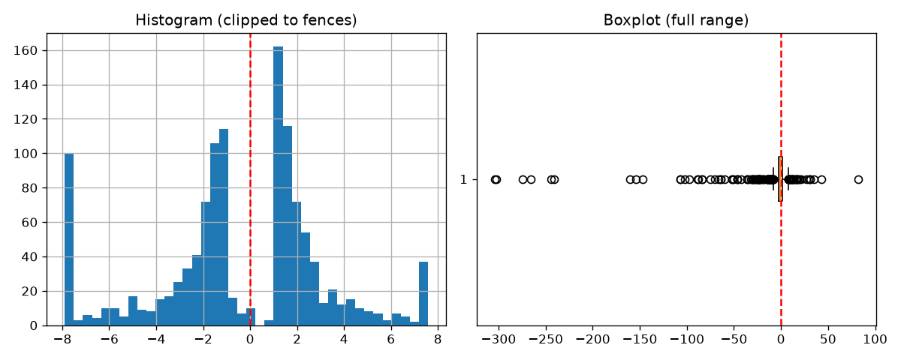
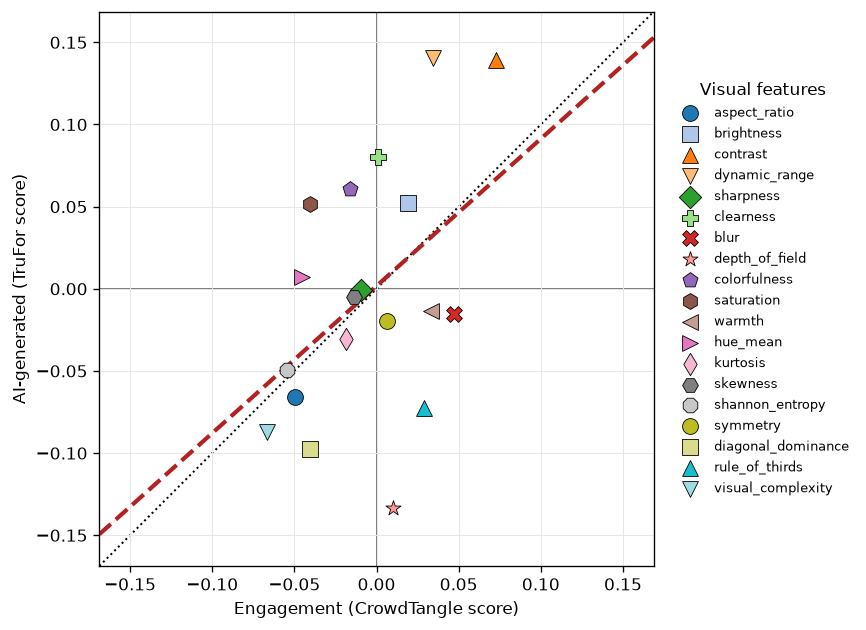

<div align="center">

# 🔍 AI Forensics in Advertising

**A TruFor-based pipeline for detecting image manipulation in social-media advertising, written in Python.**
It scores how likely each image is manipulated, describes what was altered, and relates manipulation to engagement.


</div>

---

## 📊 Results

**Initial real-world test — TruFor as a detector.** On 100 manually labelled images (threshold `0.5`): **61% accuracy**, **80.6% precision**, **47.5% recall**, **F1 ≈ 0.60** (TP 29 / TN 32 / FP 7 / FN 32). TruFor is precise but conservative here — when it flags an image as altered it is right ~4 times out of 5 (only 7 false alarms), but at the default cut-off it misses about half the manipulated images (the missed ones score well below `0.5`, so they read as confident real calls, not borderline).

On the full dataset (~1,200 photo posts):

- **Manipulation _intensity_ doesn't predict engagement.** The global `trufor_score` is essentially uncorrelated with the CrowdTangle overperforming score (Pearson *r* ≈ 0.05, *p* ≈ 0.08; OLS R² ≈ 0.003) — how strongly an image is manipulated says nothing about how the post performs.
- **But what was manipulated carries a weak-but-real signal.** TF-IDF features of the altered-region description (BLIP caption + OCR) separate over- from under-performing posts with a 5-fold cross-validated **AUC ≈ 0.64** (≈ 60% accuracy vs a ≈ 51% majority baseline), on both the raw-word (0.642) and PCA (0.632) feature sets.
- So the predictive signal is in the **content** of the manipulation (the subjects and words shown), not its **strength**.





---

## 🗂️ Project structure

```
.
├── README.md
├── LICENSE
├── requirements.txt
├── scripts/                                   # this project's pipeline + configuration
│   ├── config.py                              # single source of truth (paths + tunable knobs)
│   ├── filter.py                              # filter posts + score distribution
│   ├── trufor.py                              # TruFor scores + detector / engagement stats
│   ├── features.py                            # visual features + plot
│   ├── mask.py                                # mask the altered region
│   ├── describe.py                            # caption (BLIP) + OCR
│   ├── classification_home.py                 # runs "classification_*.py"
│   ├── classification_logistic_regression.py  # engagement: logistic regression (raw + PCA)
│   ├── classification_glm.py                  # engagement: inferential binomial GLM (+ --grid-search)
│   ├── classification_lime_shap.py            # engagement: post-hoc words (permutation + SHAP + LIME)
│   ├── utils.py                               # shared CSV / .npz / image / text helpers
│   └── temp/                                  # all generated outputs land here
├── TruFor/                                    # vendored TruFor (read-only dependency, GRIP-UNINA)
└── dataset/                                   # input data (crowdtangle.jsonl + crowdtangle_media/)
```

> 🛡️ **TruFor is a read-only dependency:** the pipeline never writes into `TruFor/` at runtime. It hands TruFor's `test.py` an `--input`/`--output` pair under `scripts/temp/` (`temp/images` → `temp/npz`), so every intermediate lives there. The vendored copy is a lightly **customised** version — a few small patches was applied — so it diverges slightly from the original GRIP-UNINA code.

---

## ⚙️ Setup

**1. Clone**

```sh
git clone https://github.com/MercuriLorenzo/AI-forense-in-advertising.git
```

**2. TruFor weights** — not in the repo (gitignored). Download [`TruFor_weights.zip`](https://www.grip.unina.it/download/prog/TruFor/TruFor_weights.zip), unzip, and place the checkpoint at `TruFor/TruFor_train_test/weights/trufor_ph3/best.pth.tar`. The `weights_only=False` fix upstream TruFor requires is already applied in this vendored copy.

**3. Python environment**

```sh
cd AI-forense-in-advertising
python3.14 -m venv .venv
source .venv/bin/activate
pip install -r requirements.txt
```

**4. Dataset** — not in the repo (gitignored). Drop your export in `dataset/`: e.g. `crowdtangle.jsonl` (one JSON post per line) and `crowdtangle_media/` (the downloaded files).

---

## 🚀 Usage

Run the six stages in order from `scripts/` (all paths come from [`config.py`](scripts/config.py)):
```sh
source .venv/bin/activate
cd scripts

python filter.py
python trufor.py [--generate-truth]
python features.py
python mask.py
python describe.py
python classification_home.py
```
`--generate-truth` (first run only) writes the empty `trufor_truth.csv` label template and pauses so you can fill the `label` column (`0` = real, `1` = AI); later runs reuse it.

Instead of `classification_home.py` it is possible to run each classification module individually:
```sh
python classification_logistic_regression.py
python classification_glm.py
python classification_lime_shap.py
```


The most useful per-stage flags:

| Option | Stage | Description |
| :----- | :---- | :---------- |
| `--batch-size`, `--wait` | [`trufor.py`](scripts/trufor.py) | Images per TruFor invocation and cool-down seconds between batches. |
| `--generate-truth`, `--threshold` | [`trufor.py`](scripts/trufor.py) | Write the `trufor_truth.csv` label template (then label 0/1); decision threshold above which an image counts as altered (default `0.5`). |
| `--method` | [`features.py`](scripts/features.py) | `pearson` or `spearman` correlation for the feature plot. |
| `--threshold`, `--conf-threshold` | [`mask.py`](scripts/mask.py) | Anomaly and confidence cut-offs a pixel must clear to be kept in the mask. |
| `--batch-size`, `--do-sample`, `--no-ocr` | [`describe.py`](scripts/describe.py) | Images per batch; sampling instead of beam search; caption-only (skip OCR). |
| `--max-words`, `--dead-zone`, `--min-df`, `--max-df` | [`classification_home.py`](scripts/classification_home.py) | TF-IDF vocabulary cap + document-frequency conditioning; drop the score valley (`\|score\| ≤ x`) before binarising at 0 (`0` disables the cut). Forwarded to the three sub-scripts it runs in turn. |
| `--max-words`, `--dead-zone`, `--min-df`, `--max-df` | [`classification_logistic_regression.py`](scripts/classification_logistic_regression.py) | Same flags, for running the logistic classification on its own. |
| `--max-words`, `--dead-zone`, `--min-df`, `--max-df`, `--alpha`, `--l1-wt`, `--grid-search` | [`classification_glm.py`](scripts/classification_glm.py) | Same TF-IDF/dead-zone flags, plus the GLM elastic-net fallback (`--alpha` strength, `--l1-wt` `0` = ridge … `1` = lasso, between = elastic net) and `--grid-search` to sweep the TF-IDF/regularization grid. |
| `--max-words`, `--dead-zone`, `--min-df`, `--max-df` | [`classification_lime_shap.py`](scripts/classification_lime_shap.py) | Same flags, for running the post-hoc interpretation (permutation + SHAP + LIME) on its own. |

> ⚠️ Media is matched to posts by reproducing `sha256(url)[:CHAR_LIMIT]`. `CHAR_LIMIT` (in [`config.py`](scripts/config.py), default `64`) must equal the truncation used at download time, or every URL→file lookup silently misses.

---

## 🔬 How it works

A six-stage pipeline; each stage appends a column to the analysis table or writes a report (see [Architecture](#-architecture)):

1. **[filter.py](scripts/filter.py)** — keeps the photo-only scored posts and symlinks their images into `scripts/temp/images/` (TruFor's input dir), then reports the `crowdtangle_score` distribution (median/skew/outliers + histogram & boxplot).
2. **[trufor.py](scripts/trufor.py)** — runs TruFor's `test.py` over those images in batches (**resumable**: one `.npz` per image, existing ones skipped; multi-megapixel images downscaled then upsampled back), records the global `trufor_score`, and — against a manually labelled `trufor_truth.csv` — writes the **detector confusion matrix** (accuracy/precision/recall/F1) plus the **Pearson/Spearman correlation** and an **OLS regression** of `crowdtangle_score ~ trufor_score`.
3. **[features.py](scripts/features.py)** — extracts ~19 (no-ML) visual features per image (aspect ratio, brightness, contrast, sharpness, blur, colorfulness, warmth, entropy, symmetry, rule of thirds, depth of field, visual complexity, …) with OpenCV/NumPy/SciPy/scikit-image, merges them into the table, and renders a feature scatter: each feature plotted by its correlation with engagement (`crowdtangle_score`, X) and with the AI-manipulation score (`trufor_score`, Y), with a fitted regression line and a `y = x` reference.
4. **[mask.py](scripts/mask.py)** — binarizes each TruFor map into a mask of the altered region (flagged and confidently localized pixels), denoises it and fixes polarity on synthetic-majority composites, saving one lossless compressed PNG per image.
5. **[describe.py](scripts/describe.py)** — captions the masked region with **BLIP** and merges the **EasyOCR** words read off it into the `anomaly_txt` column.
6. **[classification_home.py](scripts/classification_home.py)** — builds the shared text features from `anomaly_txt` — a TF-IDF representation (English + Italian stop-words removed), used both raw (one column per word) and PCA-compressed (enough components to keep 90% of the variance) — drops the posts in the bimodal score's low-density valley (`|crowdtangle_score| ≤ ENGAGEMENT_DEAD_ZONE`) and binarises the rest (over- vs under-performed).  
It then runs three **independent sub-scripts** one after another: **[classification_logistic_regression.py](scripts/classification_logistic_regression.py)** (5-fold cross-validated **logistic regression**, out-of-sample metrics + odds ratios), **[classification_glm.py](scripts/classification_glm.py)** (inferential **binomial GLM with a logit link** — coefficient table with p-values, plus a `--grid-search` mode), and **[classification_lime_shap.py](scripts/classification_lime_shap.py)** (post-hoc, model-agnostic **word-level interpretation: permutation importance + SHAP + LIME**).

---

## 🧱 Architecture

The run revolves around one growing table, `scripts/temp/dataset_filtered.csv` — most stages append a column to it, while every human-readable report is written next to it as a separate `*.txt`/`*.png`, so data and reports stay apart:

| Column | Added by | Meaning |
| :----- | :------- | :------ |
| `id` | [`filter.py`](scripts/filter.py) | Post identifier. |
| `crowdtangle_score` | [`filter.py`](scripts/filter.py) | CrowdTangle overperforming score (the engagement signal). |
| `filename` | [`filter.py`](scripts/filter.py) | Media file stem (the URL hash); the merge key for every stage. |
| `trufor_score` | [`trufor.py`](scripts/trufor.py) | TruFor global manipulation score in `[0, 1]`. |
| `aspect_ratio`, `brightness`, … | [`features.py`](scripts/features.py) | ~19 visual features, one column each (see `FEATURE_NAMES`). |
| `anomaly_txt` | [`describe.py`](scripts/describe.py) | Text description of the altered region (BLIP caption + OCR words). |

Configuration is the backbone: [`config.py`](scripts/config.py) (imported by every Python script) holds every path and tunable knob — edit it, not the scripts. Shared building blocks (CSV / `.npz` / image / text helpers) live in [`utils.py`](scripts/utils.py).

---

## ✅ How the forensic verdicts are decided

The calls are governed by a handful of thresholds in [`config.py`](scripts/config.py):

- **Detection** — an image is manipulated when `trufor_score > TRUFOR_THRESHOLD` (default `0.5`; set per run with `trufor.py --threshold`).
- **Mask** — a pixel is kept only when both flagged (`anomaly ≥ MASK_THRESHOLD`) and confidently localized (`confidence ≥ MASK_CONFIDENCE_THRESHOLD`); the raw mask is then denoised (morphological open/close + small-blob removal).
- **Polarity** — on synthetic-majority composites (a real subject on a flat banner) TruFor's mask can invert; texture asymmetry detects this and flips it so the overlay is kept, not the subject.
- **Honest empties** — a near-black mask is not captioned (the model would hallucinate) and gets the fixed label `empty`.
- **OCR text** — captioning can't read, so OCR supplies the words: low-confidence and 1–2-letter recognitions are dropped, the rest de-duplicated and capped most-confident-first.
- **Engagement** — a post over-performs when `crowdtangle_score > 0`; the bimodal distribution's low-density valley (`|crowdtangle_score| ≤ ENGAGEMENT_DEAD_ZONE`) is dropped first so the cut-off doesn't slice through ambiguous posts.

---

## ⚠️ Notes & limitations

- TruFor weights and the dataset are **not** in the repo (gitignored).
- The notion of "manipulated" is heuristic and tuned for this advertising dataset: the mask-cleanup and polarity knobs cover the observed cases, not every composite.

---

## 👥 Authors

Built and designed by:
- **[LM-official](https://github.com/LM-official?tab=repositories)**.

Powered by **[TruFor](https://grip-unina.github.io/TruFor/)** (GRIP-UNINA, CVPR 2023) — see [`TruFor/README.md`](TruFor/README.md).

---

## 📄 License

This project's own code (under `scripts/`) is released under the **MIT License** — see [LICENSE](LICENSE). **TruFor** (vendored under `TruFor/`) is third-party software by GRIP-UNINA under its own **non-commercial research license**; the [LICENSE](LICENSE) file reproduces both. Your use of this repository must comply with each.