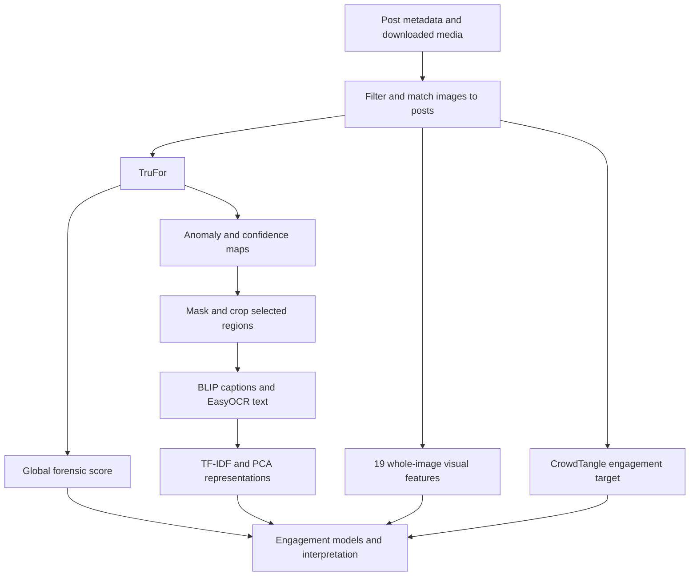

<div align="center">

# 🔍 Adv-Image-Forensics
**A Python pipeline for localizing suspected image edits and studying their association with engagement in political communication on social media.** Combine TruFor forensic maps, BLIP captions, EasyOCR text, and 19 whole-image visual features, then compare their contribution with logistic regression and binomial GLMs.


[Read the thesis](docs/tesi/L31_mercuri_tirocinio.pdf)

</div>

---

## 🔍 What it does
A research pipeline that connects image content, forensic evidence, and post engagement:
- **🧹 Filter and match posts** — select the first photo attachment, find the downloaded media, and associate each image with a reference post.
- **🔬 Localize suspected edits** — collect TruFor’s global score and anomaly/confidence maps, then select regions for inspection.
- **📝 Describe the selected content** — combine BLIP captions with Italian and English text read by EasyOCR.
- **🎨 Measure the entire image** — extract 19 visual features covering exposure, sharpness, color, intensity distribution, and composition.
- **📊 Compare engagement models** — represent descriptions with TF-IDF and PCA, then fit regularized logistic regression and binomial GLMs.
- **🔎 Inspect predictions** — use permutation importance, SHAP, and LIME to examine how words contribute to the fitted model.

### Research question
**How much do descriptions of potentially altered regions and whole-image visual features contribute to engagement classification beyond TruFor's global score? Does text add predictive value when visual features are already included?**

The distinctive step is to describe the regions selected by forensic maps and connect those descriptions to the engagement of the associated post. A separate branch measures the appearance of the entire image.

TruFor's selections are hypotheses about local alterations. Edits can include ordinary graphics, text, and campaign layouts without deceptive intent. The study examines associations and predictive performance; it does not establish that particular edits cause engagement.

> 🗣️ **Traceable outputs.** Scores, visual measurements, and descriptions meet in `scripts/temp/dataset_filtered.csv`. Maps and masked images remain alongside the reports, so each result can be traced back to its source image.

---

## 🗂️ Project structure
```text
.
├── README.md
├── LICENSE
├── requirements.txt
├── dataset/                       # Local metadata and original media
├── scripts/
│   ├── config.py                  # Paths and processing parameters
│   ├── filter.py
│   ├── trufor.py
│   ├── features.py
│   ├── mask.py
│   ├── describe.py
│   ├── classification_home.py     # Analysis runner and shared text preparation
│   ├── classification_*.py        # Four analysis modules
│   ├── utils.py                   # CSV, NPZ, text, and target helpers
│   └── temp/                      # Generated working files; ignored by Git
│       ├── dataset_filtered.csv
│       ├── images/                # Symlinks to selected originals
│       ├── npz/                   # TruFor archives: map, conf, score, imgsize
│       ├── masked/                # Selected image content saved as PNG
│       └── ...                    # Reports, figures, and optional annotations
├── TruFor/                        # Adapted third-party implementation
└── docs/
    ├── tesi/                      # Thesis source, PDF, bibliography, and figures
    └── presentazione/             # Presentation materials
```

---

## ⚙️ Setup

### 🐍 Python environment
Use Python 3.14 to match the project environment. Clone the repository and create an environment:
```sh
git clone https://github.com/LM-official/Adv-Image-Forensics.git
cd Adv-Image-Forensics
python3.14 -m venv .venv
source .venv/bin/activate
python -m pip install -r requirements.txt
```

The local TruFor implementation and BLIP select CUDA, Apple Silicon MPS, or CPU according to availability. EasyOCR uses a supported GPU when available and otherwise falls back to CPU. Runtime and feasible batch sizes depend on image resolution, device memory, and the installed PyTorch build.

### 🧠 Pretrained models
The vendored [`TruFor/`](TruFor/) directory contains local adaptations for device support, memory use, and input resizing. The final checkpoint is not tracked in Git. Download the [TruFor weights](https://www.grip.unina.it/download/prog/TruFor/TruFor_weights.zip) and place the extracted checkpoint at:
```text
TruFor/TruFor_train_test/weights/trufor_ph3/best.pth.tar
```

The wrapper uses the `trufor_ph3` configuration. BLIP uses `Salesforce/blip-image-captioning-large`; BLIP and EasyOCR fetch their pretrained files on first use, unless already cached. Initial model loading therefore requires network access or prepopulated model caches.

### 📥 Input data
The study dataset is not tracked in Git. Supply a local export with this layout:
```text
dataset/
├── crowdtangle.jsonl
└── crowdtangle_media/
    └── <sha256-of-media-url>.<extension>
```

Each JSONL line must contain a post object with `id`, a numeric `score`, and a `media` list. The first media item must have `type: "photo"` and an image URL in `url` or, as a fallback, `full`.

File stems must match `sha256(url.encode()).hexdigest()[:CHAR_LIMIT]`. The default `CHAR_LIMIT` is 64 and must match the convention used when downloading the media. Paths and processing parameters are centralized in [`scripts/config.py`](scripts/config.py).

---

## 🚀 Usage
With the environment activated, run these commands from the repository root:
```sh
python scripts/filter.py
python scripts/trufor.py
python scripts/features.py
python scripts/mask.py
python scripts/describe.py
python scripts/classification_home.py
```

The last command launches four analysis scripts sequentially. Each can also run independently once the enriched CSV contains its required columns:
| Script | Analysis |
| --- | --- |
| [`classification_logistic_regression.py`](scripts/classification_logistic_regression.py) | Five-fold logistic classification with raw TF-IDF and PCA text, both with TruFor. |
| [`classification_glm.py`](scripts/classification_glm.py) | Binomial GLMs with coefficient inference when the unpenalized fit converges, or a regularized fallback without p-values. |
| [`classification_lime_shap.py`](scripts/classification_lime_shap.py) | Permutation importance, global SHAP summaries, and five local LIME explanations of the word-based logistic model. |
| [`classification_visual_text.py`](scripts/classification_visual_text.py) | Four-model comparison, nested likelihood-ratio tests, visual coefficient analysis, and a fit-versus-validation plot. |

An optional exploratory search over TF-IDF filtering and GLM penalties runs separately:
```sh
python scripts/classification_glm.py --grid-search
```

This searches the raw TF-IDF GLM configuration, rather than the logistic model's `C` or the PCA representation. Its best score is selected on the same folds used to compare configurations.

### 🎛️ Parameters and resuming work
Use `--help` on a script for its command-line options; other settings live in `config.py`.

| Setting | Default | Control |
| --- | --- | --- |
| TruFor files per invocation / pause between groups | 50 / 180 seconds | `trufor.py --batch-size`, `--wait` |
| TruFor maximum input area | 6,000,000 pixels | `TRUFOR_MAX_PIXELS`; output maps return to original dimensions |
| Global detection threshold | 0.25 | `trufor.py --threshold`; used for the annotated detection benchmark |
| Initial mask thresholds: anomaly / confidence | 0.50 / 0.30 | `mask.py --threshold`, `--conf-threshold` |
| Visual feature resizing | Disabled | `FEATURE_RESIZE_LONG_SIDE = 0` |
| Caption batch size | 30 | `describe.py --batch-size` |
| Caption decoding | 5-beam search, 5–40 new tokens | `DESCRIPTION_*`, `MIN_DESCRIPTION_TOKENS`, `MAX_DESCRIPTION_TOKENS`; `--do-sample` enables sampling |
| OCR | Italian and English; confidence ≥ 0.65; at most 20 distinct words | `OCR_*`; `describe.py --no-ocr` disables OCR |
| Description exclusion | Non-black pixels ≤ 2% | `EMPTY_MASK_PIXEL_RATIO`; excluded inputs receive `nomask` |
| TF-IDF vocabulary | At most 100 terms; document frequency ≥ 5 and ≤ 40% | `--max-words`, `--min-df`, `--max-df` on classification scripts |
| Classification score exclusion | [-0.5, 0.5] | `--dead-zone`; `0` disables the exclusion |
| Text PCA | Retain 90% of variance | `PCA_VARIANCE` |
| GLM fallback penalty | Ridge, α = 0.0007 | `classification_glm.py --alpha`, `--l1-wt` |

TruFor skips existing `.npz` outputs. Interrupted description runs resume from `scripts/temp/description_temp.csv`; completed runs merge the descriptions into the analysis table and remove that checkpoint. Cached outputs assume unchanged inputs, models, and parameters. When changing those settings, regenerate the affected outputs or use a separate working directory through `config.py`.

`filter.py` recreates the analysis CSV. Later enrichment stages replace overlapping columns, use inner joins on `filename`, and drop rows with missing values. Preserve completed outputs before restarting a full run, and inspect row counts after enrichment.

### 🏷️ Optional manual evaluation
Annotations are optional for normal inference and engagement analysis.

- `python scripts/trufor.py --generate-truth` creates `scripts/temp/trufor_truth.csv` with `filename` and `label`, then prompts for completion. Use `0` for authentic and `1` for altered. For an annotated subset, retain only labeled rows. This option recreates the template, so omit it when reusing existing annotations.
- Place pixel-level reference masks in `scripts/temp/masked_truth/`, matched by file stem, with white for altered pixels and black for authentic pixels. `mask.py` computes its evaluation report when this directory is available.

The global detection threshold and the pixel-selection thresholds serve separate purposes. Masking runs on images with available maps regardless of the global detection decision.

---

## 🔄 How it works


| Stage | Script | Main operation |
| --- | --- | --- |
| Filter | [`filter.py`](scripts/filter.py) | Select the first photo attachment, match it to a local file, resolve repeated media, and summarize engagement. |
| Forensic inference | [`trufor.py`](scripts/trufor.py) | Run pretrained TruFor, collect global scores and maps, and analyze the score's association with engagement. |
| Visual features | [`features.py`](scripts/features.py) | Measure 19 properties of the original image and report Pearson and Spearman correlations. |
| Region selection | [`mask.py`](scripts/mask.py) | Combine anomaly and confidence thresholds, apply a texture-based inversion heuristic and morphological cleanup, and save selected content on black backgrounds. |
| Description | [`describe.py`](scripts/describe.py) | Caption the masked content with BLIP, recognize Italian and English text with EasyOCR, and merge the normalized text. |
| Statistical analysis | [`classification_home.py`](scripts/classification_home.py) | Run logistic classification, inferential GLMs, word-level explanations, and comparisons of the information blocks. |

TruFor, BLIP, and EasyOCR use pretrained weights. The engagement models are fitted on the study sample. Image localization and description do not use engagement labels.

---

## 🧱 Architecture
The shared analysis table is **`scripts/temp/dataset_filtered.csv`**. Its `filename` column is the media file stem and the join key across stages.

| Columns | Meaning |
| --- | --- |
| `id`, `crowdtangle_score`, `filename` | Reference post, observed engagement score, and media identifier. |
| `trufor_score` | Global forensic score in [0, 1]; higher values indicate stronger evidence of manipulation according to TruFor. |
| The 19 visual columns listed below | Whole-image measurements in their defined scales. |
| `anomaly_txt` | Normalized BLIP caption followed by filtered OCR words, or `nomask`. |

Text normalization folds accents, lowercases words, and removes numbers and punctuation. TF-IDF removes Italian and English stop words and `nomask`; descriptions with no retained terms become all-zero text vectors, including `nomask` cases.

### 🎨 Whole-image visual features
The visual branch operates independently of masking. Its 19 measures are:
| Family | CSV columns |
| --- | --- |
| Tone and exposure | `brightness`, `contrast`, `dynamic_range` |
| Focus and sharpness | `sharpness`, `clearness`, `blur`, `depth_of_field` |
| Color | `colorfulness`, `saturation`, `warmth`, `hue_mean` |
| Intensity distribution | `kurtosis`, `skewness`, `shannon_entropy` |
| Composition and structure | `aspect_ratio`, `symmetry`, `diagonal_dominance`, `rule_of_thirds`, `visual_complexity` |

### 📄 Reports and figures
Reports and figures are written under `scripts/temp/`, including:
- `dataset_distribution.txt`, `engagement_istogramma.pdf`, and `engagement_boxplot.pdf`.
- `trufor_crowdtangle_correlation.txt`, `trufor_crowdtangle_regression.txt`, and `trufor_crowdtangle_glm.txt`.
- `images_features_pearson.txt`, `images_features_pearson.pdf`, and the corresponding Spearman files.
- `description_report.txt` and the four classification reports: `classification_logistic_regression.txt`, `classification_glm.txt`, `classification_explanations.txt`, and `classification_visual_text.txt`.
- `classification_explanations.pdf`, `classification_explanations_bars.pdf`, and `classification_model_comparison.pdf`.
- Optional `trufor_confusion_matrix.txt`, `mask_confusion_matrix.txt`, and `classification_glm_grid_search.txt`.

Thesis figures are preserved in [`docs/tesi/immagini/`](docs/tesi/immagini/).

---

## 🗃️ Dataset & engagement
The thesis studies public Facebook and Instagram posts from 15 May to 14 August 2024, covering the 2024 European election period. The archive contains 1,357 posts from 66 accounts: 28 Facebook accounts and 38 Instagram accounts.

Each observation links one image to the engagement of one reference post. Filtering keeps posts with an available score, a first attachment of type `photo`, and exactly one matching local file. If several posts reference the same media identifier, the post with the highest engagement score is retained; ties keep the first occurrence. Matching uses URL hashes, so visually identical images at different URLs can remain distinct.

| Sample stage | Observations | Details |
| --- | ---: | --- |
| Original post archive | 1,357 | — |
| Images selected by filtering | 1,212 | 386 Facebook images and 826 Instagram images. |
| Enriched table after subsequent processing | 1,211 | One degenerate 1 × 1 PNG excluded. |
| Final classification sample | 1,195 | 16 observations in the central score interval excluded; 583 above-expectation and 612 below-expectation cases. |

Engagement comes from CrowdTangle's `score`, an overperforming measure relative to comparable posts from the same account. It includes corrections for low interaction counts and is not a raw interaction total. With the default exclusion interval:
- Class 1: `crowdtangle_score > 0.5`.
- Class 0: `crowdtangle_score < -0.5`.
- Scores in [-0.5, 0.5], including the endpoints, are excluded from classification.

Descriptive statistics and continuous-score correlations retain the central observations. Engagement concerns the complete post, including context and attachments that the selected image alone cannot represent.

---

## 📊 Results reported in the thesis
The results below summarize the experiments documented in [Chapters 4](docs/tesi/capitoli/04_localizzazione_descrizione.tex) and [6](docs/tesi/capitoli/06_associazione_engagement.tex). They apply to that dataset and protocol.

### 🔬 Forensic detection, masking, and descriptions
- **Detection:** on 100 manually annotated images, a global-score threshold of 0.25 gives 75.0% accuracy, 78.46% precision, 82.26% recall, and 0.8031 F1. The majority baseline is 62.0%; score-based AUC is 0.7538. Thresholds were compared on this same exploratory sample.
- **Masking:** pixel precision is 78.12%, recall 39.69%, and mean per-image IoU 0.3501. Selecting the entire image gives mean IoU 0.6351 on these annotations. The masks recover less than half of the annotated altered pixels, despite higher precision than that baseline.
- **Descriptions:** 898 of the 1,211 processed images receive usable text; 313 receive `nomask`. This label denotes insufficient visible content or no usable normalized text, rather than a finding of authenticity.

### 📈 Engagement classification
TruFor's global score has a weak association with continuous engagement: Pearson r = 0.055, p = 0.05760 and Spearman ρ = 0.043, p = 0.1368, on 1,211 observations. Neither test is significant at the 5% threshold.

The L2-regularized logistic model uses TruFor plus either 100 TF-IDF terms or 61 PCA components retaining 90% of text variance. Five-fold classification results on 1,195 observations are:

| Predictors | Accuracy | ROC AUC |
| --- | ---: | ---: |
| Majority-class baseline | 51.2% | — |
| TruFor + TF-IDF text | 59.4% | 0.644 |
| TruFor + PCA text | 59.4% | 0.638 |

The separate comparison of four unpenalized binomial GLMs uses the same observations and five common folds:

| Predictors | Predictor count, excluding intercept | In-sample McFadden pseudo-R² | Validation Q_CV |
| --- | ---: | ---: | ---: |
| TruFor | 1 | 0.0009 | -0.0060 |
| TruFor + PCA text | 62 | 0.1369 | 0.0234 |
| TruFor + visual features | 20 | 0.0624 | 0.0278 |
| TruFor + PCA text + visual features | 81 | 0.1605 | 0.0128 |

`Q_CV = 1 - L_CV / L_0` compares validation log loss with a constant-probability reference based on class prevalence. Higher values indicate lower loss; negative values are worse than the reference. It is distinct from in-sample McFadden pseudo-R², and neither is a proportion of variance explained.

Text and visual features each improve validation relative to TruFor alone. Combining them improves the training fit but lowers validation performance relative to either intermediate model. These results show modest predictive capacity; they do not establish redundancy between the information blocks. In the TruFor-plus-visual model, only `aspect_ratio` remains significant after Benjamini–Hochberg correction across the 19 visual tests.

**Evaluation scope:** TF-IDF, PCA, and visual standardization are learned before splitting the sample, and the null reference uses full-sample prevalence. Logistic regression and GLMs use different fold schemes; neither separates accounts or periods. These choices can make the estimates optimistic and limit conclusions about generalization.

---

## 📚 Thesis & documentation
The thesis is written in Italian. Its chapters provide the detailed methods, definitions, experiments, and references behind this README:
1. [Introduction](docs/tesi/capitoli/01_introduction.tex): research question, approach, and contribution.
2. [Background and related work](docs/tesi/capitoli/02_background_related_work.tex): TruFor, visual descriptors, captioning, OCR, and statistical tools.
3. [Pipeline, dataset, and filtering](docs/tesi/capitoli/03_pipeline_dataset_filtraggio.tex): data provenance, engagement definition, selection, and sample counts.
4. [Localization and description](docs/tesi/capitoli/04_localizzazione_descrizione.tex): forensic evaluation, masks, BLIP/OCR, and examples.
5. [Whole-image visual features](docs/tesi/capitoli/05_caratteristiche_visive.tex): definitions, extraction, and representation limits.
6. [Association with engagement](docs/tesi/capitoli/06_associazione_engagement.tex): protocols, results, model comparisons, and explanations.
7. [Conclusions, limitations, and future work](docs/tesi/capitoli/07_conclusioni_limitazioni_sviluppi_futuri.tex): interpretation and proposed follow-up experiments.
8. [Bibliography](docs/tesi/references.bib): bibliography.

To rebuild the thesis, install a LaTeX distribution with `latexmk`, pdfLaTeX, BibTeX, and the required packages, then run:

```sh
cd docs/tesi
latexmk -pdf tesi.tex
```

The build uses the bundled `sapthesis` class and produces `tesi.pdf`. See the [thesis README](docs/tesi/README.md) and [`packages.tex`](docs/tesi/packages.tex) for layout configuration.

---

## ⚠️ Notes & limitations

- **Validation and selection:** preprocessing uses the full sample before validation, and the exploratory grid search has no outer evaluation split. Performance differences lack uncertainty intervals. Future evaluation should fit transformations within training folds and use nested validation.
- **Sample and dependencies:** the study covers two platforms, 66 accounts, and three months. Selecting the highest-scoring occurrence of repeated media affects the sample. Folds do not separate accounts or time periods, and GLM inference uses non-robust standard errors. New-account and temporal evaluations remain necessary.
- **Forensic scope:** the 100-image benchmark uses one annotator and also informs parameter choices. TruFor addresses local alterations; a low score does not verify that an image is authentic or exclude full-image synthesis.
- **Automatic representations:** masking can remove useful context; BLIP can hallucinate and OCR can misread text. Caption and OCR outputs are merged, with no quantitative evaluation against reference descriptions. Visual features depend on resolution, compression, and image content.
- **Interpretation:** permutation importance, SHAP, and LIME inspect a model refitted on its training sample. Correlated words and implausible tabular perturbations limit their interpretation. They do not identify causal effects on engagement or provide campaign-design prescriptions.
- **Unresolved comparisons:** the study does not establish that describing suspicious regions is better than describing the entire image. Matched whole-image descriptions, separate BLIP/OCR analyses, and explanations evaluated on held-out data are proposed next steps.

---

## 👥 Authors
Adv-Image-Forensics was designed by:
- **[Lorenzo Mercuri / LM-official](https://github.com/LM-official)**
- Supervisor: Prof. Matteo Cinelli
- External supervisor: Prof. Mattia Samory

for the bachelor's thesis in Computer Science at Sapienza University of Rome, academic year 2025/2026:
> *Localizzazione, interpretazione ed analisi computazionale del fotoritocco nella comunicazione politica sui social media*


Powered by **[TruFor by GRIP-UNINA](TruFor/README.md)**.

Bibliographic references are collected in the [thesis bibliography](docs/tesi/references.bib).

---

## 📄 License
Released under the MIT License. See [LICENSE](LICENSE).

The vendored TruFor code is covered by its separate [LICENSE](TruFor/TruFor_train_test/LICENSE.txt).