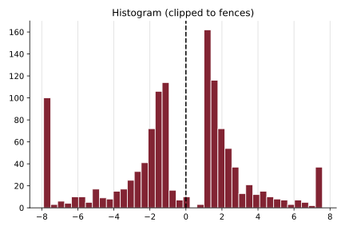
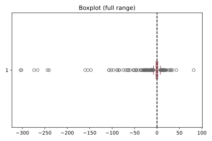

# **Dataset — Elezioni europee 2024**

## **Origine:**
Il dataset raccoglie i post pubblici di advertising politico pubblicati su Facebook ed Instagram nel periodo delle elezioni europee 2024, estratti tramite [CrowdTangle](3%20Definizioni.md#crowdtangle). I post coprono l’intervallo dal 15/05/2024 al 14/08/2024 (data in cui CrowdTangle è stato dismesso da Meta).

## **Come lavorava CrowdTangle:**
CrowdTangle era una piattaforma di content discovery ed analisi di Meta, pensata per misurare le prestazioni social dei contenuti pubblici. Tracciava i post (link, testi, foto e video) di pagine, gruppi e profili pubblici verificati: una pagina Facebook entrava nel sistema se aveva superato almeno una volta dal 2014 i 110 mila like, oppure se era stata aggiunta ad una lista CrowdTangle da un qualsiasi utente; erano esclusi i post indirizzati ad un pubblico ristretto tramite gli strumenti di targeting di Facebook (es. limitazioni di età o geografiche). Per ogni post esponeva i metadati (tipo, testo, link, data) ed i contatori di interazione — like e altre reaction, commenti di primo livello, condivisioni, visualizzazioni — accumulati dalla pubblicazione fino al momento dell’interrogazione.  
*Fonte: [CrowdTangle Codebook](https://socialscience.one/crowdtangle-codebook), Social Science One*.

## **Struttura:**
Il dataset contiene:
1. `crowdtangle.jsonl` — 1357 post, uno per riga in formato JSON: 521 di Facebook e 836 di Instagram, tutti con punteggio di engagement.
2. `crowdtangle_media/` — 1441 file multimediali scaricati dagli URL dei post: 1192 `.jpg`, 98 `.mp4`, 82 `.heic`, 20 `.webp`, più 49 file di streaming o senza estensione.

## **Schema di un post:**
Ogni riga del `.jsonl` è un oggetto JSON con i metadati del post. I campi usati dalla pipeline sono:

| Campo | Significato |
| :---- | :---------- |
| `id` | Identificatore del post. |
| `score` | Punteggio di engagement di CrowdTangle (vedi sotto). |
| `media` | Lista degli allegati; di ognuno si usano `type` (es. `photo`, `video`) e l’URL (`url` o `full`). |

Gli altri campi (piattaforma, data, testo del post, statistiche di interazione effettive ed attese, numero di iscritti, link) sono conservati ma non processati dalla pipeline.

## **Punteggio di engagement (score):**
È l’*overperforming score* di CrowdTangle: confronta le interazioni effettivamente ottenute dal post con quelle attese, previste dallo storico di post simili dello stesso account. Un punteggio maggiore di 0 indica un post che ha superato le aspettative (over-performing), minore di 0 un post che le ha deluse (under-performing). Ad esempio, un post con 351 like a fronte dei 12 attesi ottiene score 19.56.

Le interazioni attese (benchmark) sono calcolate dagli ultimi 100 post comparabili lungo tre dimensioni: stesso account, stesso tipo di post e stessa età del post (in fasce temporali che crescono da 15 minuti a 24 ore). I 100 post vengono ordinati per interazioni, si scartano i 25 migliori ed i 25 peggiori (per compensare la [distribuzione a legge di potenza](3%20Definizioni.md#distribuzione-a-legge-di-potenza)) e si media il 50% centrale; soglie minime di interazioni evitano punteggi instabili quando i numeri sono piccoli.  
*Fonte: [CrowdTangle Codebook](https://socialscience.one/crowdtangle-codebook), Social Science One*.

Sul dataset filtrato la [distribuzione](3%20Definizioni.md#distribuzione-statistica) del punteggio è bimodale, con una valle a bassa densità attorno allo 0: [mediana](3%20Definizioni.md#mediana) -0.75, [media](3%20Definizioni.md#media-aritmetica) -3.51 (trascinata dagli estremi negativi, minimo -304), [asimmetria](3%20Definizioni.md#asimmetria-statistica-skewness) -8.47, e il 10.5% di [outlier](3%20Definizioni.md#outlier) oltre le [Tukey fences](3%20Definizioni.md#intervalli-tra-quartili-iqr---tukey-fence). Si riportano [istogramma](3%20Definizioni.md#istogramma) e [box-plot](3%20Definizioni.md#box-plot):

## **Nomenclatura dei file multimediali:**
Ogni file in `crowdtangle_media/` è nominato con l’hash SHA-256 (in esadecimale) dell’URL da cui è stato scaricato, troncato a `CHAR_LIMIT` caratteri (64 di default, cioè l’intero hash). La pipeline ([filter.py](../scripts/filter.py)) ricalcola lo stesso hash dagli URL dei post per associare ogni post ai suoi file su disco: per questo `CHAR_LIMIT` (in [config.py](../scripts/config.py)) deve coincidere con il troncamento usato al momento del download, altrimenti ogni ricerca URL→file fallisce silenziosamente.

## **Filtraggio (filter.py):**
Il primo stadio della [pipeline](7%20Pipeline.md) ([filter.py](../scripts/filter.py)) legge il `.jsonl` e conserva solo i post analizzabili. Un post è valido se:
1. ha il punteggio di engagement (`score`);
2. ha almeno un elemento in `media`;
3. **tutti** i suoi media sono di tipo `photo` (un solo video scarta l’intero post);
4. ogni URL ha il file corrispondente su disco (tramite l’hash) e nessun hash è in collisione.

L’output è `scripts/temp/dataset_filtered.csv` (colonne `id`, `crowdtangle_score`, `filename`; una riga per immagine, ordinato per `filename`) e i symlink alle immagini valide in `scripts/temp/images/`. Il filtraggio non modifica il dataset originale.

Dai 1357 post di partenza (1466 media citati: 1348 foto e 118 video) restano **1217 immagini analizzabili**.

## **Ground truth:**
Per valutare l’affidabilità del detector, un sottoinsieme di 100 immagini è stato etichettato manualmente (0 = reale, 1 = alterata) in [trufor_truth.csv](../results/trufor_truth.csv); è la [ground truth](3%20Definizioni.md#ground-truth) della [matrice di confusione](3%20Definizioni.md#matrice-di-confusione) del detector.